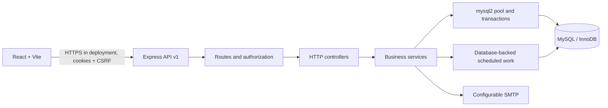

# LibraCore

LibraCore is a campus library management system built with React, Vite, Express, and MySQL. The current frontend covers authentication, role-aware dashboards, catalogue and inventory, member administration/self-service, circulation, reservations, fines/manual payment records, notifications, reporting, and system administration.

## Current Delivery Status

Implemented in the repository:

- Cookie-based JWT access and refresh sessions, CSRF checks, login throttling, password hashing, and backend permission middleware.
- MySQL connection pooling, transactional service helpers, migrations, and fictional development seeds.
- Catalogue search, book/copy management APIs, member APIs, circulation issue/return/renewal, reservations, fines/payments, notifications, reports, audit, and settings APIs.
- Frontend login/session restore, staff/member dashboards, catalogue search and inventory title/copy management, notification read actions, member directory/self-service, preview-confirm issue/return workflows, reservations, fine waivers/manual payment records, reports, settings, staff access, branches, and audit review.
- Backend smoke/policy tests and frontend build/lint scripts.

Not yet complete or verified:

- Remaining UI gaps include cover uploads, bulk CSV import/export for catalogue/member records, advanced inventory movement editing, reservation fulfillment controls, full payment history, book-review submission, and notification preferences.
- The backend has password reset request/reset endpoints, but account email-verification completion is not implemented; enabling required verification can leave self-registered accounts pending.
- Database-backed integration/concurrency tests and complete frontend component/workflow tests.
- Complete OpenAPI request/response schemas, query-plan capture, and performance benchmarks.
- Docker Compose execution (Docker is not installed in the current development environment).
- MySQL migration/seed execution (local MySQL rejected the configured `libracore` account with `ER_ACCESS_DENIED_ERROR`).
- Production deployment, live email delivery, and any payment-provider integration.

The project is a development foundation, not a production-ready deployment. Do not expose development credentials or the Compose defaults to the internet.

## Architecture



The primary relationship chain is `users -> member_profiles -> memberships`; bibliographic `books` are distinct from physical `book_copies`; `loans` reference a copy, member profile, membership, issuing staff member, and branch. Reservations point to a title and optional allocated copy. Fines reference a member and optional loan/copy; payments and adjustments preserve financial history. See [docs/database-design.md](docs/database-design.md).

## Requirements

- Node.js 22 recommended.
- MySQL 8.0+ (the Compose file uses MySQL 8.4).
- Docker Compose is optional for local containerized development.

## Local Development

1. Create a development database and user in MySQL, or use the Compose instructions below.
2. Copy `backend/.env.example` to `backend/.env` and set database and local-only secrets. The frontend reads `VITE_API_URL` from `frontend/.env` when present; `frontend/.env.example` is provided.
3. Install dependencies and initialize the schema:

```powershell
cd backend
npm ci
npm run migrate
npm run seed
npm run dev
```

In another terminal:

```powershell
cd frontend
npm ci
npm run dev
```

Frontend: http://localhost:5173  
API health: http://localhost:4000/health  
Swagger UI: http://localhost:4000/api/docs

The app's backend reads `backend/.env`. The seed refuses to run when `NODE_ENV=production`. Seeded accounts/passwords are development-only and configurable through `SEED_ADMIN_*`, `SEED_LIBRARIAN_PASSWORD`, and `SEED_STUDENT_PASSWORD`.

Default development super-admin sign-in (when the seed settings are not overridden):

- URL: http://localhost:5173/admin/login
- Email: `admin@libracore.local`
- Password: `ChangeMe#Admin1`

This account is created by `npm run seed`; it is not a public admin-registration flow. If the account already exists, the seed does not reset its password. Set `SEED_ADMIN_EMAIL` and `SEED_ADMIN_PASSWORD` in `backend/.env` before first seeding if you want different development credentials. Never use these defaults in production.

## Docker Compose

The included Compose definition is intended for local development. Set strong local values in a root `.env` before starting it; defaults are intentionally documented development values.

```powershell
docker compose up --build
```

The backend waits for MySQL, applies migrations, runs the development seed, then starts Express. Because Docker was unavailable during authoring, image build, service health, and Compose startup remain unverified here.

## Tests and Checks

```powershell
npm --prefix backend test
npm --prefix frontend run lint
npm --prefix frontend run build
```

Backend tests currently cover health/CSRF/error responses and pure circulation-policy calculations; the UI and MySQL workflows still need integration coverage. More detail is in [docs/testing-strategy.md](docs/testing-strategy.md).

## Security Notes

- Browser credentials are HttpOnly cookies; do not move access/refresh tokens to localStorage.
- Mutating `/api/v1` requests require the CSRF cookie value in `x-csrf-token`.
- Authorization is enforced by backend middleware and permission checks; frontend navigation visibility is usability only.
- Configure production cookie flags, CORS origins, database grants, secrets, TLS, backups, SMTP, and log retention before deployment.
- No live payment gateway is configured. A recorded payment is an internal library record and must not be presented as online payment processing.

## Project Documentation

- [Requirements and implementation status](docs/requirements.md)
- [Architecture](docs/architecture.md)
- [Database design](docs/database-design.md)
- [API documentation](docs/api-documentation.md)
- [Testing strategy](docs/testing-strategy.md)
- [Deployment guide](docs/deployment-guide.md)
- [User manual](docs/user-manual.md)
- [Project report outline](docs/project-report-outline.md)