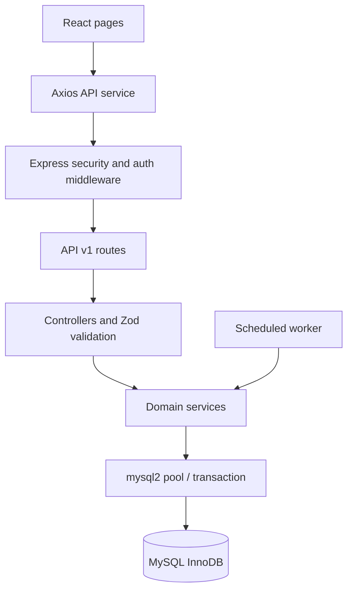

# Architecture

## Components

- `frontend/src`: React Router application, session context, Axios service, and user-facing pages.
- `backend/src/routes`: versioned REST route registration and authorization middleware.
- `backend/src/controllers`: request parsing, response status, and response envelopes.
- `backend/src/services`: business policies and MySQL transaction composition.
- `backend/src/database`: mysql2 pool, migration runner, SQL migrations, and development seed.
- `backend/src/jobs`: scheduled overdue, reservation, and notification work.
- `backend/src/notifications`: email and in-app notification delivery.

## Request Boundaries

Routes enforce authentication and named permissions. Controllers translate HTTP into service input and return `{ data: ... }` responses. Services own eligibility, state transitions, and transaction logic. The error middleware emits a stable `{ error: { code, message } }` envelope and avoids stack traces in production.

## Authentication

JWT access and refresh credentials are cookies. Refresh tokens are stored by SHA-256 hash and rotated on refresh. Mutating API calls require the CSRF cookie value in `x-csrf-token`. Frontend route protection improves navigation only; the Express permission middleware remains the security boundary.

## Phases

1. Foundation: backend app, MySQL schema/seed, frontend shell, health route, setup scripts, and health tests are implemented. Local migration verification is blocked by the configured MySQL account grant.
2. Authentication and authorization: cookie sessions, refresh rotation, CSRF, permissions, login, registration, password change, forgot-password, and reset-password UI/API are present. Email-verification confirmation and broader auth tests remain.
3. Catalogue and inventory: search, title/copy creation, details, archive, and restore are present. Cover uploads, bulk operations, barcode labels, and copy-state editing UI remain.
4. Members: directory, registration, status, detail, self-service profile, renewals, reservations, and reading list actions are present. Imports/cards and broad member workflow tests remain.
5. Circulation: issue/return/renew logic and preview-confirm staff UI are present. MySQL concurrency verification remains.
6. Reservations/notifications: queue list, title reservation, cancellation, notifications, and scheduled jobs are present. Fulfillment controls and notification preferences remain.
7. Dashboards/reports: database-backed dashboards, date-range reports, charts, and CSV export are present. Branch-specific coverage and analytics tests remain.
8. Administration: settings, users, branches, and audit review UI is present. Integrations and complete multi-branch policy remain.
9. Hardening: smoke/policy/schema tests and lint/build exist; MySQL integration, frontend, E2E, accessibility, and production security review remain.
10. Delivery: documentation and development Compose files exist; Docker and clean-install validation remain unavailable in this environment.