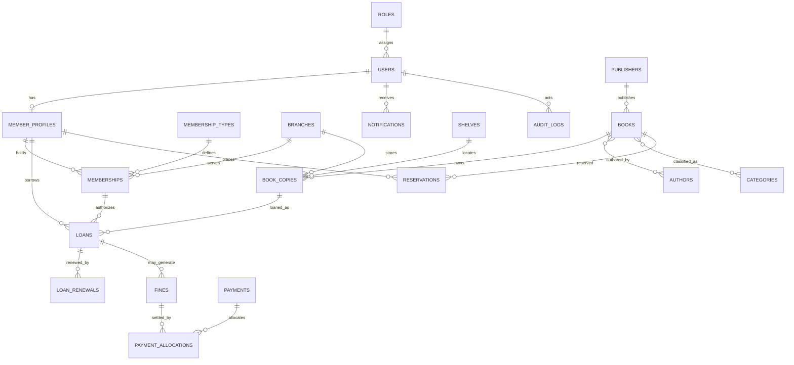

# Database Design

The authoritative schema is [001_initial_schema.sql](../backend/src/database/migrations/001_initial_schema.sql). It uses InnoDB, `utf8mb4`, foreign keys, unique identifiers, indexes, UTC-oriented timestamps, and `DECIMAL` monetary fields.

## Relationship Diagram



## Table Groups

- Identity and authorization: `users`, `roles`, `permissions`, `role_permissions`, refresh/reset/verification token tables.
- Membership: `member_profiles`, `memberships`, `membership_types`, and `branches`.
- Catalogue and location: `books`, `authors`, `book_authors`, `publishers`, `categories`, `book_categories`, `book_copies`, and `shelves`.
- Circulation rules and transactions: `loan_policies`, `operating_hours`, `holidays`, `loans`, `loan_renewals`, and `reservations`.
- Finance: `fines`, `payments`, `payment_allocations`, `payment_adjustments`, and `fine_waivers`. Corrections are append-oriented records; payment history is not deleted to fix a discrepancy.
- Operations: `inventory_movements`, `acquisitions`, `notifications`, delivery logs/preferences, `audit_logs`, settings, search history, and imports.

## Key Decisions

- A `books` row represents bibliographic metadata; a `book_copies` row represents a uniquely barcoded physical item.
- Authors and categories are many-to-many; publisher is optional many-to-one.
- Loans retain member, membership, copy, branch, and staff relationships for history.
- Money uses `DECIMAL`; mysql2 keeps decimal values as strings by default (`decimalNumbers: false`).
- ISBNs, copy codes, barcodes, member codes, and role/permission codes have uniqueness constraints where applicable.
- Historical records should be archived or status-transitioned rather than deleted.

## Query and Index Rationale

Search and circulation rely on indexes for ISBNs, copy barcodes, role/status, branch/status, loan member/status/due dates, and reservation title/status/queue order. The book table has a FULLTEXT index for supported catalogue search; current service queries use escaped parameterized `LIKE` clauses for multi-field searches.

Example validation query (run against a seeded MySQL database):

```sql
EXPLAIN
SELECT id, title, isbn13
FROM books
WHERE status = 'active' AND isbn13 = '9780132350884';
```

Capture `EXPLAIN` output on the actual MySQL version and seed volume before making performance claims. The current project has not recorded benchmark plans or load tests.

## Migration and Backup

Run migrations with `npm run migrate`; applied filenames are recorded in `schema_migrations`. Before an upgrade or deployment, back up using `mysqldump --single-transaction`. Restore into a clean database and verify the restored migration and seed state before enabling traffic.